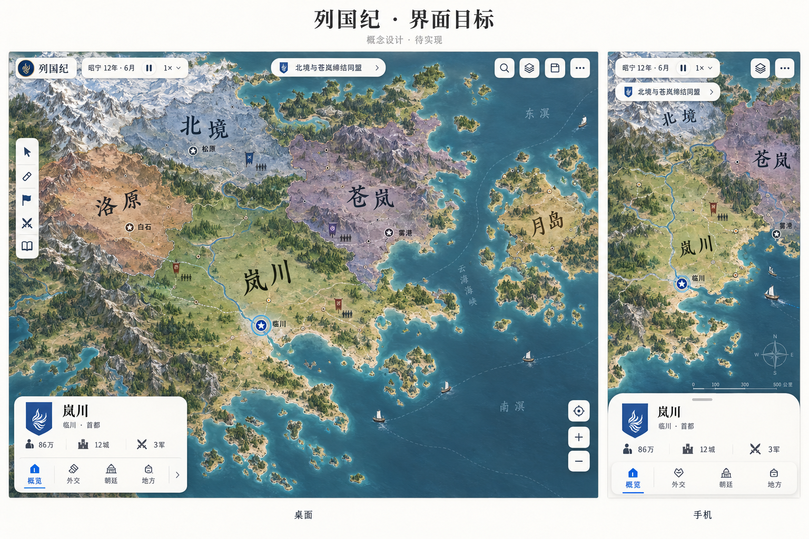

> **已被主计划取代（2026-10-19）。** 2026-10-08 温白 iOS 图标 UI 和本目录目标图作废。界面照原作重建，见 [主计划](../../MASTER_PLAN.md) 第 6 节。概念图不是原作对照，也不是实现证据。

# 列国纪 · Atlas UI 目标 v1

2026-10-08，用户明确要求叠加 UI UX Pro Max、Hallmark、Emil，并生成最终版本感觉的图片。此指令覆盖上一切片“不用 skills”的执行方式；不抹去前一切片的完成证据。发布、原作复用和旧档约束不变。

这是内置 image_gen 生成的概念设计，不是现有网页截图、原作截图或技术可行性证明。图中人物、国名、地形与统计是说明布局的虚构样例，不能冒充正式设定或已存在的游戏数据。生成提示词见 [PROMPT](PROMPT.md)。

## 三份资源的实际使用

| 来源 | 本轮用途 | 边界 |
|---|---|---|
| [UI UX Pro Max](https://github.com/nextlevelbuilder/ui-ux-pro-max-skill) | 本机已有；检索设计系统、地图产品与 React 指南。采用触控尺寸、信息层级、响应式等通用规则 | 初次检索返回营销展示页，地图检索返回停车产品；均不当成游戏专用方案，不采用 hero/CTA/仪表盘布局 |
| [Hallmark](https://github.com/Nutlope/hallmark) | 用官方 skill-installer 将 skills/hallmark 安装到 Codex skills；借鉴 spatial map structure 19 和消除卡片套卡片的约束 | 该结构本为地图/流程图网页，游戏不需要落地页页脚、CTA 或进入页面逐点绘制动画；这些不套用 |
| [Emil](https://github.com/emilkowalski/skills) | 本机 emil-design-eng 已有；沿用可中断的 transform/opacity、指针与键盘区分、减少动态 | 概念图不能证明动画手感；不加库、不改变真实模拟时间或制造装饰战斗 |

本次直接应用已确认的 iOS、地图主导、图标优先方向，没有要求用户重复填写主题问卷。Hallmark 新安装项可能需要重启后才出现在后续会话的技能列表；本轮已直接读取并应用，无须为本次生成重启。

## 目标与具体约束

- 地图承载地形、政治和军队；UI 只承载当前决策。国家色留给地图，系统蓝表示当前操作。
- 温白控件 `#faf9f6`、正文 `#27323e`、次级正文 `#65717b`、操作蓝 `#2868c4`。地图目标海色偏沉静灰蓝，不能在未对照原作和测量前随意改实际地理数据。
- UI 使用本机系统无衬线；国名保留地图字体。每个可操作图标保留可访问名称、选中状态与最少 44px 触区。图中看似更小的控件不是像素级验收规范。
- 桌面详情按内容收短，长内容内部滚动。手机保留短抽屉与拖动收起，详情最大 38dvh 是本批已有工程值；概念图约 25% 的更短状态仍是后续目标，不能提前宣称达到。
- 统计数字直接排在面板上，不再用另一层白卡；分类使用图标、短标签和细蓝下划线，保留键盘方向键/Home/End与隐藏页草稿。
- 点按约120ms、下拉约160–180ms、抽屉200ms，使用既有可中断过渡；键盘和减少动态不播放不必要动画。大面积控件采用较不透明底色，移除其 backdrop blur；性能改善须另测，不能由此宣称帧率。

## 本批已写入的最小实现

| Before | After | Why |
|---|---|---|
| 桌面详情由 top/bottom 拉成通高右栏 | 左下角按内容收短、最大 min(56dvh,540px)，长内容滚动 | 避免简单选中占据整条地图 |
| 编辑与游戏为多种冷蓝灰浮层，统计再套白卡 | 共享温白方向，统计去底框，系统蓝集中于操作 | 降低底框数量，地图国家色更容易辨认 |
| 分类栏灰色整块、白色胶囊；国色是一根色条 | 图标与细下划线，小盾形国色标记；旧交互和可访问名称不变 | 更接近目标图，同时沿用已测功能 |

实际源文件：src/fms/play/play-live.css、play-inspector.css、src/fms/fms-interface.css。35个本地图标体系继续使用，本批未凭空声称新增图标数量。

## 仍有差距

1. 生成图的山脉与森林带有较强插画感，不能算与原作一致；实际目标仍需原作同视角对照。先实现地形数据驱动的层次，不能整张贴图替代地图。
2. 图中标签位置、国界和海岸是构图，不保证拓扑、拾取、保存一致。实际 renderer 必须用同一份游戏数据。
3. 图中短标题使用年号；当前真实版本使用第几日，不能仅改 UI 伪造年号系统。
4. 图中的无边际感不是无限世界证明；全景/4/16/40倍、连续缩放和性能仍按真实工程验收。
5. 生成字形和图标不是生产 SVG，需逐一实现；本图不进入 dist。
6. iPhone Safari/Chrome 真机、用户视觉认可、完整原作等价均待验。

## 接续顺序

此图作为当前界面方向，而不是另起项目或整套重构。先完成本批短卡/表面与浏览器证据；之后沿当前 Army/海域/文化任务继续实现，同步逐项套用目标 UI。下一界面切片聚焦国家标题/核心统计与时间导航的版位，保留全部确认、取消、保存与冲突提示。地图美术另按原作几何和数据渲染合同推进，不用概念图代替证据。
