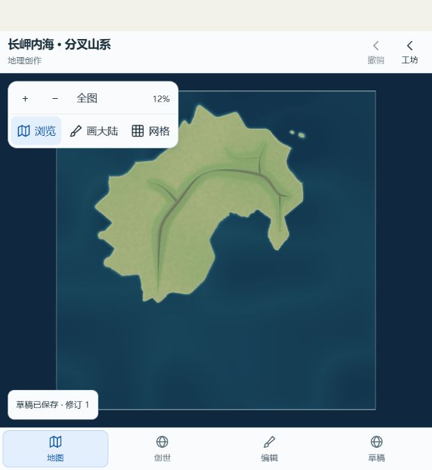
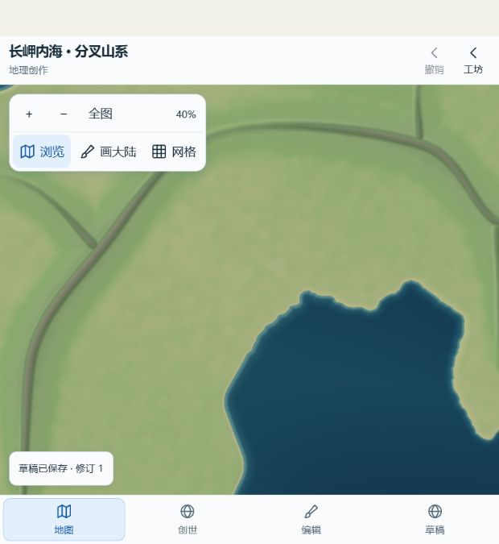

# preview.22：分叉细山系与海洋材质

本批仅本地开发。真实画面仍为平滑管状山脉，**自然视觉未通过**；不标PH06完成，不发布。新版Atlas尚无国家、行政区、城市、首都、军队或战争；旧0.4功能不作为新版完成证据。

## 实际变更

- 新细山系依据大陆可用陆地规划主脊与分支，将细高程写入真实可编辑数据；旧默认/local计算路径保留。新增规划支持最多5条链，旧预算192候选/262144索引引用/4096支撑不变。
- 密度保护首次发现海峡夹具旋转支撑的空包围盒角使单桶达到193；保守旋转投影仅移除不可能贡献的引用，819支撑/5条链与真实贡献累加顺序不变。该场景最大候选116；10917查询与独立全支撑累加核对。
- 海洋颜色按实际深度连续变化，抑制海底坡度在水面上的过强明暗；陆地材质字节保持原样。CPU与GPU材质共同版本化，原存档地理不改写。
- 接入实际preview.21的11个历史生成标识，仅用于读取保存的数据；旧配方不获重新执行授权。冻结源码与原build元数据保留。

## 检查与真实画面

实际版本 **0.5.0-preview.22**，build.json SHA256 **517215bfffe6125531d90b8540ad53f358547c3739ff63f3ca64a4c60f410be2**。原build.commit **d651bcc9502d5afe31fef80d0a17b9a9988bc819** 如实保留；之后本地提交号见AUTO_HANDOFF，不改构建原件。正式配置38文件306/306，计划/lint/类型/构建/dist通过，11生成闭包重算匹配：8项仅历史变化、3项运行时变化；模拟引擎指纹不变。实际生产GPU316探针、5条接缝通过，原高程1/128米、颜色2字节、接缝1字节容差未扩大。

| 浏览器仿真 | 流程耗时 | 结果 |
| --- | ---: | --- |
| desktop-chromium | 201.980 秒 | PASS |
| mobile-chromium | 205.872 秒 | PASS |
| tablet-chromium | 285.969 秒 | PASS |

三端在同一源码和dist上执行原生绘制两陆、预览取消、保存追加、旧地形保护、撤销、真实刷新、细地形拾取、重叠拒绝和错误检查；450秒预算、零重试。移动浏览器仿真不是真机，流程耗时不是交互延迟或性能验收。

IAB还真实恢复旧21草稿修订1，在相同12%视野对照海洋材质；新22采用同41点轮廓/种子/参数，独立保存刷新修订1，22.09%陆地、高程−5897至2046米。

实际观察：三端全图与中景、IAB同地形海色A/B及新大陆全图/40%中景已实际查看。海色青光明显减弱，但山脊仍是光滑匝道状圆管，侧谷与山块层次不足，海岸仍偏圆软。未发现本次截图上的规则方块高程色格，不能因此认定自然地貌通过。国家行政城市与战争尚未接入。

自然视觉、用户视觉、真机、性能、整个PH均未通过。没有云端写入，旧站保持原样。

## 保留的失败与证据边界

联合first为302通过/3未执行，原因是上述密度保护；修复后正式repair-1为306通过。Fine候选first类型失败、repair-1浮点边界失败、repair-2通过；Sea候选first138/140、repair-1通过。密度定向38执行通过但writer suite宏缺失使整体失败，随后重跑中断无JSON；最终仅正式306轮作为组合验收。所有原始结果、失败、源字节及SHA保存在[原始归档](ph06-natural-range-sea-2026-09-28/verification.json)。Fine早期候选未在当次检查时捕获全部依赖，补充来源明确为检查后；不把候选检查外推为最终生产源验证。

## 下一批

修正真实山脉高程的同质宽度、横截面和谷地分支遗漏，先看实际地形小样再做整批集成。PH07双页receiver继续隔离工程验证，支撑真实跨页流向，不增加边界调试面板。国家、行政、城市与兵种按既有PH依赖接入，不用空面板或缩放装饰冒充。
