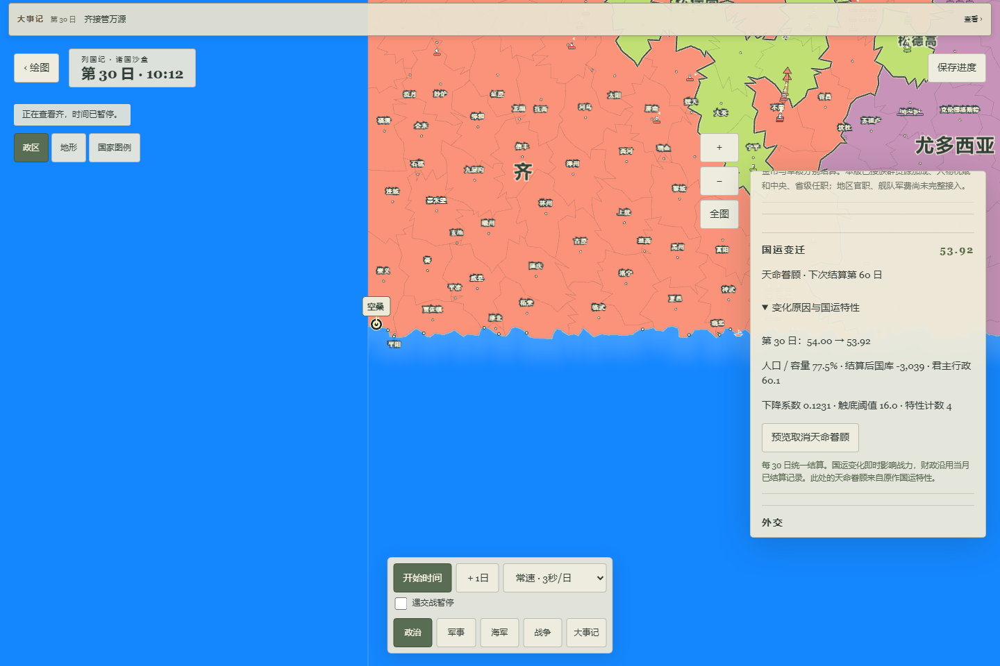
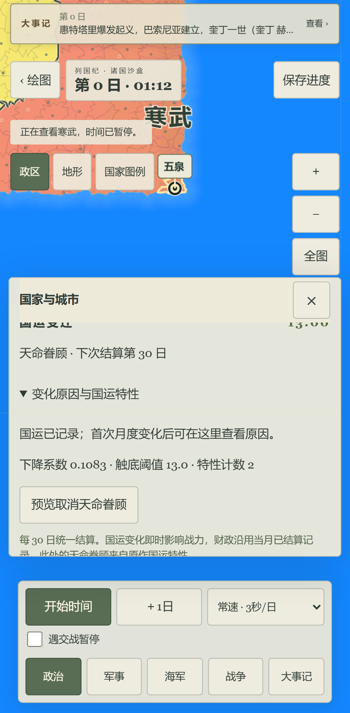

# v20 国运：本地可玩结果

2026-10-07，WEB-PH04 / WEB-04-13继续进行。最新本机入口 http://127.0.0.1:5193/?fms=1 ，独立生产构建 `.autopilot/destiny20-final-preview/dist`。v20 / Store22 / `lieguoji-fms-destiny-v20`，引擎 `8c86ffb84d46b7e45a2fbd5f7ac88772a9fbee672d452bf12544e2c8c4a2d382`。不是在线Pages地址，其他设备不能使用此PC的127.0.0.1。

## 现在可玩

- 每国国运按真实人口比例、已结算金币、真实君主行政能力逐月变化；达到阈值按已恢复的原函数重抽。国运影响后续战力。打开国家可以查看本月前后数值、原因、衰减率与下次结算日。
- 可以预览、取消、确认“天命眷顾”；启用刷新原计数，保留当前国运。改其他特性与改政体分开处理。手工编辑国运支持完整float32小数，极小指数形式也能继续编辑政体，不强制四舍五入。
- 国运、随机流、重抽次数、月记录、动员冷却独立持久化。加载不重抽；旧局继续使用原规则，必须明确创建副本才进入v20，旧库不写。v19执行源已冻结验证。

具体原RVA、公式、原月日历与当前网页30日月结差异见[合同](CONTRACT.md)。当前顺序仍是财政→国运→后续动员，原作普通动员在国运前；这项交由下一规则切片，不称完整月序相同。

## 已实际操作

三个尺寸的正式构建浏览器测试全过，0重试：手绘大陆、六文化选名、真实Worker新局、推进暂停、保存/深链接刷新/精确checksum恢复、首都起义预览取消及确认、母国迁都、新国与史书恢复、和平第三国的天命预览取消及确认、再次精确恢复。桌面还通过正式时间控制走到第30日，验证月账/变化前后及原因，保存刷新恢复相同新国运、财政账与月游标。页面、控制台error及失败资源请求均空。[浏览器报告](browser.json)。

手机与平板项目是Chromium移动仿真，不是iPhone13ProMax Safari/Chrome真机。没有用户视觉、性能或完整原作等价结论。

另外通过正常界面手绘不规则大陆并生成六国，威尔登费尔泽由萝莎琳一世治理、首都法韦利佐沃。启用天命后国运40、计数2保存刷新保持；极小小数试验后恢复40。页面停在第0日、暂停、慢速6秒/日、全图，操作和保存均通过普通UI，未向真实试玩库注入夹具。

## 检查与范围

全量3127单元/264文件通过，lint、类型、24发布规则、15计划规则、计划校验、生产构建与43产物审查通过，时间与命令见[checks](checks.json)。该全量启动后补写的独立动员核未算在其中，单列18项最终通过，尚无生产调用。UI继续标签与极小小数表单修正后的最终lint/types另记。

源码和产物SHA见[tested-artifact](tested-artifact.json)，核对最新dist与浏览器受测5193产物逐文件相同。build.json中的938769f是父HEAD，实际脏树另绑定，不冒充干净提交或云CI。首轮真实继续标签失败保留[FAILURES](FAILURES.md)，未删除测试；完整trace只留.autopilot，不进入Git或dist。

新增可提交内容仅源码、测试、既有授权资源的派生代码/来源记录、合成测试截图与审查后的结果；没有新增原安装包、dump、凭据、真实个人存档。原27项特性JSON已在早期授权范围复用，本批未另复制安装包。没有push、PR、Issue、Pages触发或main改动；旧正式站和全部旧库保留。

暂存78文件路径审查与私钥/GitHub/AWS凭据模式检查均无命中。`git diff --cached --check`仅报告两处继承的文件末空行：v19冻结结构源和v20复制结构源；按已验证兼容/引擎指纹保留，未将此项记作全通过。没有新增语义错误或关闭lint规则。

下一批按[NEXT_MUSTER](NEXT_MUSTER.md)接普通动员与主战/主和特性；特殊强国榜单、完整人物家族/年龄、宗教、原月日历、PWA、真机与视觉仍未通过。总Goal持续，不以本批测试完成代替完整还原。
