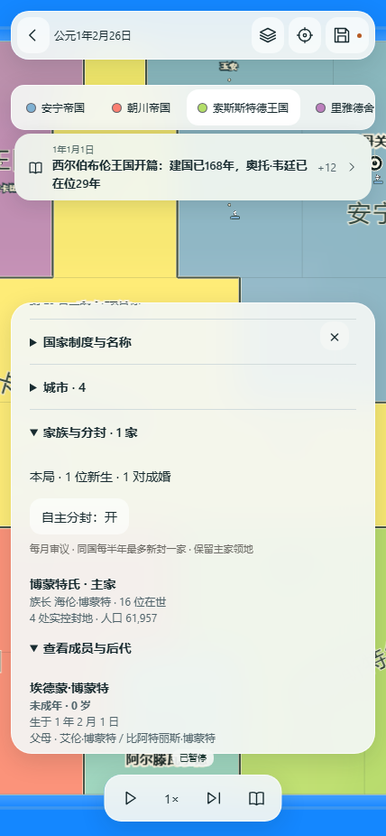

# WEB-04-43：新局世代家谱闭环

实现源码：`a4a79b1 feat: add isolated generational births and family continuity`。这是本地、可回退的新局规则切片；没有修改既有旧档、没有推送或触发 Pages。

## 本批实际行为

- 新建文化世界会显式写入 `enable-generations`，并只存入 `lieguoji-fms-culture47-generations-v1`。旧世界、补军副本和历史冻结引擎不被静默升级。
- 已婚且符合年龄、近亲和配偶约束的人物会按独立的持久随机流生育。孩子具有真实父母、生日、文化化姓名、家族归属、子女双向引用和人物履历；成年后可以成婚、再次生育，并可在合规条件下继任国家职务。
- 授封时的 `memberIds` 仍是历史快照。后出生人口通过出生账加入当前家族，不回写旧授封；活着的后代会阻止把仍有人口的家族误判为绝嗣。
- 家谱详情、家族面板和史书能够展示出生与成婚；查看详情不会要求暂停时间。

这套出生频率、配偶选择和调度是网页适配规则 `known-couples-birth-household-web-v1`，并非已恢复的原作完整婚育算法。

## 实际检查

- 相关 Vitest 首轮：8 个文件、75 项通过；新增跨代专项：`civilization47-generations.test.ts` 的 9 项通过，其中包含连续 60 年、由本局出生者成年成婚并再生育的断言。
- 生产构建：`npm run build` 通过；`check-dist` 审核了 85 个允许产物。
- 浏览器：Chromium 桌面端 6/6 通过，覆盖正常新局出生→家谱/史书→冷恢复、冻结 fe7 不升级、家族保存恢复、两个退役来源及暂停终点。最后一次复核曾因临时 5306 服务已退出而得到 `ERR_CONNECTION_REFUSED`；不把它当作功能失败，启动同一审计产物后重新运行得到 6/6，两个日志和结果均保留。
- 实际本机页面：生成过普通 6 国 60 城世界，运行至公元 2 年 5 月 7 日，史书中可见文化化父母与新生儿记录；该人工局未作为冷恢复证据。

## 本机试玩与边界

- 已核验构建入口：`http://127.0.0.1:5306/?fms=1`，仅当前电脑可访问；它与 5300/5304/5305 的旧入口分端口存储，未迁移旧存档。
- Chromium 竖屏检查不等于 iPhone 13 Pro Max 的 Safari/Chrome 真机验收；用户视觉、原作节奏与完整原作等价仍未通过。
- 未执行 GitHub push、Cloudflare Pages、PR、Issue 或生产部署。
