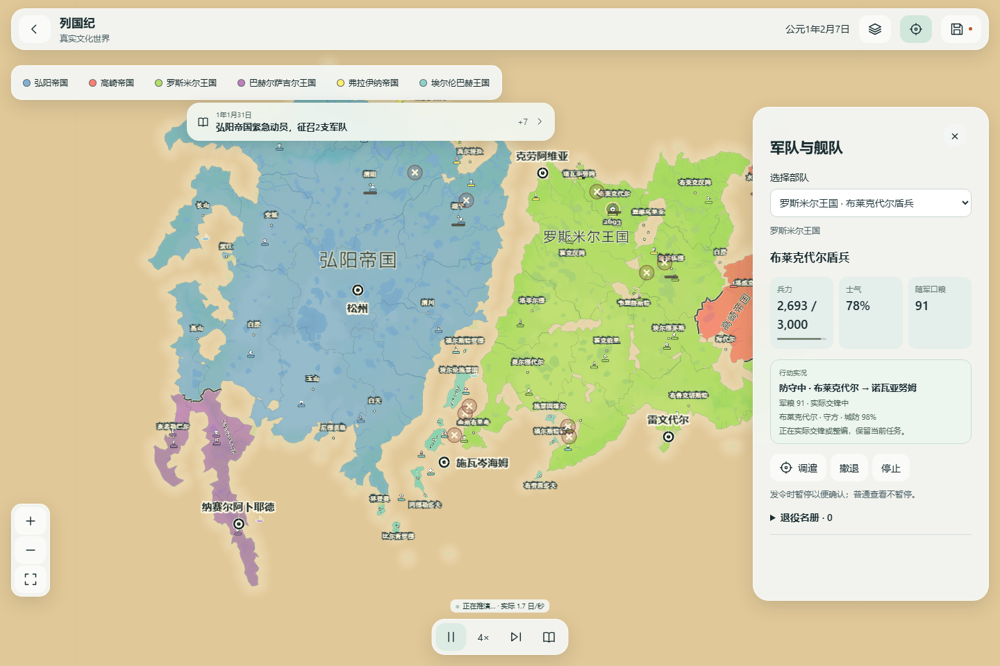

# 本地试玩修复：创建耗时、运行长等待、兵力条及交战位置

日期：2026-10-15。当前源码提交 `c3d44e1bf2bb3bafe0b425d87f6ee266350bb9cd`，分支 `codex/ph06-world-generation`。用户明确要求修复生成慢、需要暂停重开的偶发停顿、军队下面的横条及交战点偏移。按三个关联项目完成这一批本地修复。

本机试玩入口：**http://127.0.0.1:5330/?fms=1**。检查产物为 `.autopilot/fms-live-fixes47-checked`，引擎 `b489d7b7275b84a86dc1f5472412ef474d132757461106f57ea52c05bd437639`。构建元数据记录此前 HEAD `03a5b4bb5371dc9879e22e73f8dd12e70934ecf6`，该工作树随后提交为上述源码提交；本轮已单独核对产物引擎与当前源码指纹一致。没有云端构建、push、Pages、Cloudflare、main 或原安装包写入。旧入口与个人存档未读取或覆盖。

## 修复和可观察行为

1. **重复寻路与重复创建地理。** 正常1337多大陆、6国60城战乱开局，旧版首次480 tick自动推进在24秒观察内没有回复，主线程仍能操作按钮；实际旧Worker采样显示Dijkstra占主要耗时。现在同一军队、同一决策阶段保留Dijkstra前沿，依次查询候选目标，选中目标和立即发令可复用搜索。浮点舍入、代价、通行约束、队列成本及ID平局排序保留。上下文绑定军队、run、day、tick、nextEventId、位置revision和binding，改令后不能复用。创建及验证过程中共用经过逐项内容比较的真实行军图，并且只对深层冻结的几何缓存相等结果；可变地形缓冲继续逐项校验，私有事务提交前仍检查变更。不缩小地图、不跳日、不改变兵力或战斗规则。
2. **真实兵力横条。** 旧横条是固定长度的国家颜色。新版用 `world.armies[].troops / tactics.forces[id].fullStrength` 画国家色填充，底槽保留；多人聚合按各自满编总数计算，损失、恢复及保存不会把当前人数重新当成满编。军事详情同时显示当前/满编和可访问的完整度条。实际浏览器截图出现2693/3000受损军队，相应横条缩短。原作方法只读分析确认 `Army.GetMaxArmyCount` 取故乡地区的编制上限；本次使用现有网页注册满编字段作桥接，不宣称逐像素原作等价。
3. **交战点跟随同一显示帧。** 旧版按整个行政区合并交锋，且标记用最新结算位置、图标用缓冲动画位置；因此容易出现跨地点的平均点和时间错位。新版按实际接触cell对分点，逐帧投影到部队图标当前显示中心，包含图标布局偏移、海陆动画和相机变换。远景隐藏图标仍可使用该帧实际坐标。只投影已接受的真实接触账，接触消失后移除，围攻继续依赖活动围攻名单，不捏造战斗或伤害。

## 实际验证

- 针对性回归13文件181项通过；补充与重跑2文件38项通过，后者包含寻路上下文失效和冻结几何比较测试，两组有重叠，不相加冒充总数。
- `typecheck`、`lint`、本地构建与91个允许产物检查通过。完整测试套件未重跑。
- 桌面和Pixel7尺寸Chromium执行真实整图预览/取消/对照/确认/撤销/重做/保存恢复，以及连续实际移动、暂停和地图点选，共6/6通过。手机尺寸模拟不是iPhone真机或Safari验收。
- 正常整图战乱世界持续65秒采样，切到4×、暂停恢复后继续，到tick15960（133日）；共观察到最多8个真实交战点、49个受损军队采样，推进请求最多同时1个、无页面错误。标记与同帧部队图标的最大采样偏差约0.000093 CSS px，详细样本见 `normal-world.json`。保存后冷恢复的tick、所有实际部队位置和兵力精确一致。
- 已冻结上一版3a65引擎的原Worker字节：1410350字节，SHA256 `08cdc329af58124178d8731b734235673d8b77cd0b754ea094af95cbac51880a`。旧版继续推进/保存/冷恢复1/1通过，原engine和历史保留。注册表25个冻结引擎与对应字节验证通过。
- 正常浏览器旧样本地形预览约2.11秒、创建约17.47秒，首次推进24秒未回复。新样本在详细诊断和其他回归任务并行时，预览约4.00秒、创建约15.08秒、首次回复约4.65秒，后续回复约1.20–3.85秒。地形预览算法本批没有改变，不能将这些并行耗时当成精确提速倍率；独立Worker同输入比较另列 `exact-worker-comparison.json`。

第一份探索脚本使用错误的恢复按钮名超时，属于测试脚本选择器错误；原失败日志保留。纠正为“进入世界 → / 继续文化世界”后，完整验证通过。未把该失败记作游戏恢复故障。

原版及新版检查产物里的真实Worker字节又分别在独立Node进程顺序执行；使用同一份实际1337地形、6国60城和退役/伤兵恢复/世代账目，未与浏览器回归并行。结果如下（单次本机观测，不能推算其他设备或所有世界）：

| 相同输入的计算 | 原版 | 新版 |
| --- | ---: | ---: |
| 创建世界 | 21.39秒 | 13.80秒 |
| 首次480 tick推进 | 40.58秒 | 5.72秒 |
| 第二次480 tick推进 | 0.58秒 | 0.62秒 |
| 第三次480 tick推进 | 0.56秒 | 0.58秒 |

创建耗时在该观测中减少约35%，首次长等待减少约86%；后续两批原本已较快，没有宣称普遍加速。7个检查点的整个序列化run SHA256全部相同，仅归一化随机生成的run ID。包括兵力、位置、战斗账目、人口、财政、外交和自主军令的实际字段；没有改写规则指纹来让旧档经过新规则运行。详情见 `exact-worker-comparison.json`。

## 本地入口与边界

在当前电脑打开上述5330入口：预览整张地图 → 确认整图 → 进入世界 → 选择战乱开局 → 从当前地图创建文化世界 → 继续时间。点击军事模式可查看军队横条和当前/满编人数。仅在当前电脑使用，服务重启后应重新检查；旧5320检查产物仍保留。现有旧档按原冻结引擎继续，所以旧模拟耗时保持原规则；创建新世界才能试玩本批优化，不静默迁移旧档。

4×仍是请求速率，实际吞吐受地图和模拟计算限制，UI单独显示实际日/秒；本批不声称达成目标速率，也不声称所有超长历史/设备特有卡顿均被排除。完整PH、原作视觉、iPhone13ProMax真机和用户验收未通过，WEB-04-37仍in_progress、WEB-04-21仍blocked，发布锁不变。

代码和证据均由Git保存，可通过独立本地revert撤销本批源码提交；旧引擎与原始产物仍可用于对比。不要覆盖旧档，不要在Claude与Codex两边同时编辑同一文件。续接入口为根项目 `docs/AUTO_HANDOFF.md` 和 `plan/tasks.json.webRebuild.culture47LiveFixesCheckpoint`。
