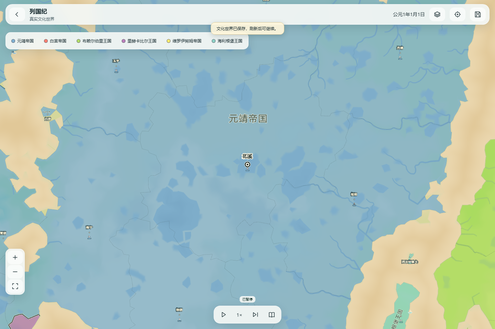
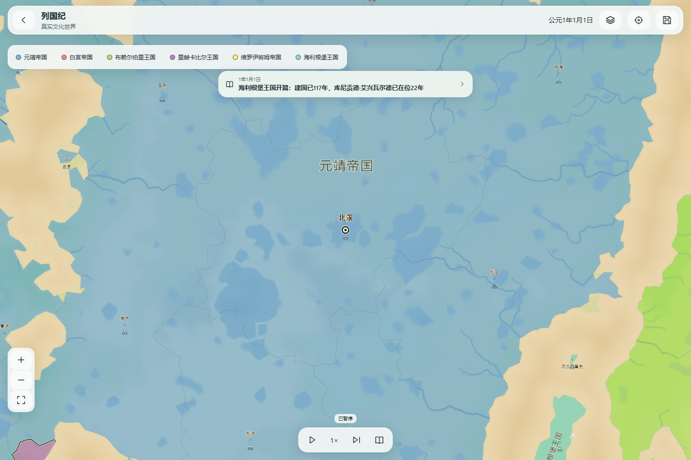
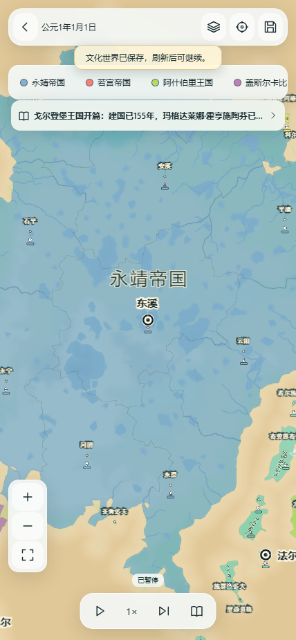
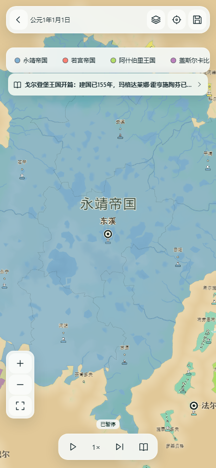

# 地图墨色文字、详细还原提示词与真实试玩

日期2026-10-15。源码检查点 `187b72e9d15e114d13954a8eed2d27adb36e6072`，分支 `codex/ph06-world-generation`。本轮用户要求“继续朝着原作设计，写详细提示词并执行”。本地开发，没有push、Pages、Cloudflare、main或原安装包写入，未读取或覆盖个人世界。

## 本批实际改动

完整提示词在 [FMS_ORIGINAL_STYLE_EXECUTION_PROMPT_2026-10-15.md](../../FMS_ORIGINAL_STYLE_EXECUTION_PROMPT_2026-10-15.md)。包含当前实时基线、十类差距、对应模块、实施顺序、原作/网页适配区别、旧档与发布边界、检查与交付要求；沿用唯一任务表，未另建阶段账。已实际执行其第一批地图文字切片。

续接时发现工程已到 `7095d6b`，此前整图闭环和寻路/兵力/交战显示修复已有最新提交，故没有重写它们。最初旧七文件检查调用的输出停在RUN，环境续接后会话不可用，**不计通过**。本批基于最新源码另行执行下述定向检查。

当前文字算法本来已支持国名按每个实际连片倾斜、世界坐标锚定及首都名避让。本次没有虚构“重新完成国名算法”。可见改变是：政治地图普通城市/辖区地名采用黑褐墨色、常规字重、细浅描边；首都保留较大字号和独立圆环，减薄原3px字描边，连接线也更轻。地形模式使用浅字/深细边，军队人数、战斗与选中提示仍采用原语义。不同视图使用独立复用键，切换不会留下上一视图的文字样式。地图、城市坐标、国家控制、AI、时间和保存规则未改。

原作视觉参照是用户提供的十张真实截图，观察到纸面上的墨色国名、小地名和首都环；本次是有依据的**网页排版适配**，未恢复原Unity字体或逐像素字形。[官网](https://www.fantasymapsimulator.com/)和[Steam商店](https://store.steampowered.com/app/3035500/)于本轮打开，用于核对创世与自主历史的产品范围；未观看新视频，不以商店简介证明排版公式。

## 同一世界的前后对照

每个尺寸先由旧检查产物实际生成1337多大陆、6国60城和平世界并保存，再在全新候选origin/context中导入**该测试自建世界**。不读用户世界。类型数组和校验保留，候选通过真正的原 `b489` Worker载入。

两组视口为1440×960、428×926，均为桌面Chromium。全景、以同一真实首都为中心的4/16/40倍（相对全图fit）共四个视角，逐项断言前后相机、tick、国家名、城市名、地理位置及实际部队位置完全相同。相机由真实UI缩放和拖动操作；没有改世界数据以制造对照。

| 桌面4倍，修改前 | 同世界同相机，修改后 |
|---|---|
|  |  |

| 竖屏4倍，修改前 | 同世界同相机，修改后 |
|---|---|
|  |  |

完整全景和16/40倍在本目录 `desktop/{before,after}`、`portrait/{before,after}`。前后冷载入的顶部保存提示与快讯播放时刻不同，因此不能把整张UI图片的所有像素当作同一动画帧。实际地图、相机和tick已单独精确核对。字体依赖本机宋体/系统衬线回退，其他设备要重新看，不声称已经达到原作字体一致。

## 检查结果

- 5文件23项定向单测通过：连片标签、文字避让、事件分类、冻结字节及客户端。`typecheck`、完整`lint`、生产构建及92个允许产物检查通过。构建`build.json.commit`精确绑定源码 `187b72e`，引擎 `b40d1ffdfeacd50d7c7a0589f2aacae8414ed9ea6fc352d9a5cdeca34819f95f`。
- 前后截图采集4个独立浏览器context完成；候选桌面与竖屏都验证平移24×17 CSS px时33个国名连片锚点不变，实际标签盒随镜头平移，世界tick和部队位置不变。
- 候选分别点击真实“松阳”“云阳”打开对应城市/国家详情，切换政治/地形显示，再连续推进到tick600。保存冷恢复后tick与实际部队位置精确一致，两种尺寸页面异常均0。
- 新引擎新建整图6国60城、实际推进、保存刷新恢复，桌面Chromium专用流程1/1通过（49.1秒是整条测试耗时，不能称世界创建耗时）。
- 单独使用实际冻结原`b489` Worker创建、继续、保存、刷新，保留原engine/id/history的浏览器回归1/1通过。
- `plan:check`、`test:plan`和`test:release`在记录完成后执行，结果见同目录日志和verification最终字段。完整测试套件未重跑；没有真实云端CI或手机真机结果。

原`b489`字节已冻结到 `compat/culture47/engine-b489.js`：1,411,371字节，SHA256 `b60be7d8053c2e2c7e5d1e8bcf7cf9d71592b3a89f46ae9d41d8c79257e08857`。来源是实际检查产物原字节，未替换指纹常量；注册表现为26项。仅因本项目保守运行源指纹涵盖地图TS，排版变化也创建新引擎标识，旧世界仍由其原Worker运行。

## 试玩与未完成事项

本机入口 **http://127.0.0.1:5331/?fms=1**，不可变检查产物 `.autopilot/fms-map-typography47-checked`。仅监听这台电脑，不能从手机直接访问；老5330/5320产物未覆盖。重启或续接须重新检查服务。

操作：空白海洋 → 预览整张地图 → 确认整图 → 保存地图 → 进入世界 → 自定文化/国家/城市数量 → 创建文化世界 → 继续时间。已有旧局按原引擎继续，视图使用本批排版；不静默迁移旧规则。

**尚未达到原作整体设计。** 实际图仍能看到折线海岸、粗地形色块、稀疏近景城市以及顶部多条UI；4/16/40倍记录有意保留这些差距，没有挑一张较好看的图充验收。字号与细描边尚需真机可读性、用户审美判断。完整战争战略、双大陆900日、分裂因果、宗教/政体、家族等沿原任务继续，不因排版改动而宣称完成。4×实际吞吐目标、iPhone13ProMax Safari/Chrome、原作视觉和全部发布门仍开放。

下一批优先对照同一输入的海岸/地形与近景差距，选择一个可量测的实际改进；若出现可复现玩法阻断先修，不再回头重做已验证的整图、存档和重复寻路。WEB-02-02保持todo/部分证据，WEB-04-37保持in_progress，WEB-04-21保持blocked。

本批源码可通过本地revert提交回退，冻结引擎与前后产物均保留；此处没有执行回退或改写历史。检查方法脚本为 `run-browser.mjs`，测试自建世界样本保存在忽略的 `.autopilot/fms-map-typography47-browser/`，不提交或部署原始存档。
