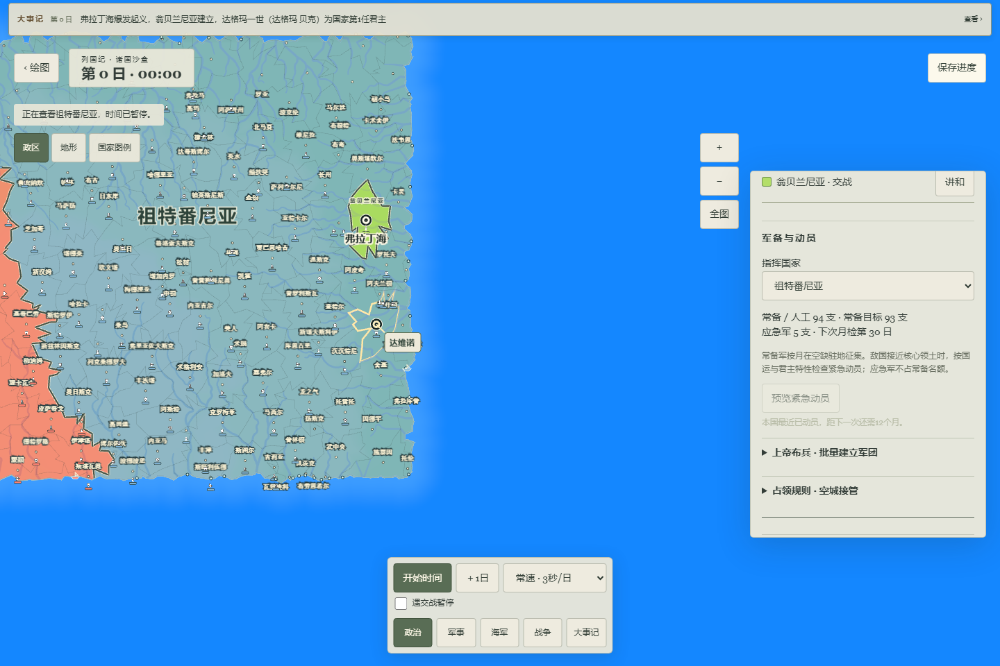
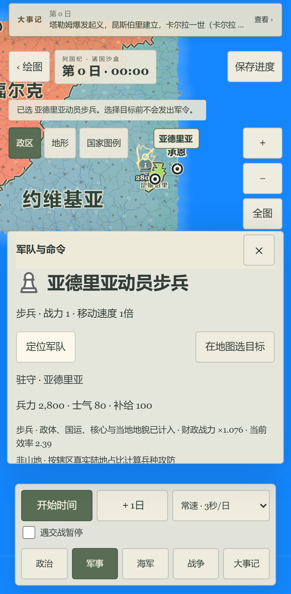

# v21 普通动员与君主特性：本地可玩结果

最新入口 http://127.0.0.1:5194/?fms=1 ，独立本机构建 `.autopilot/muster21-preview/dist`；v21/Store23/`lieguoji-fms-muster-v21`，engine `b462edef9aeb3393bb019f8d43567f6c3a439f5193668a53450af06fe69072c9`。WEB-PH04/WEB-04-13及完整还原Goal继续，未自动完成完整PH或原作验收。

普通应急军数量现在按真实国运和现任君主原特性计算，预览与Worker一致。国运50中性5支、主战7支、主和禁止；国运0仍按原逻辑记录冷却但不造假军队。只有核心领土前线接敌才进入普通动员，自动月检读取衰减前国运。该月随后发生国运重抽时，清近期队列而保留冷却。详见[原函数、网页桥与未接分支](CONTRACT.md)。

实际三尺寸生产浏览器全过、0重试：正常绘制小大陆→二国新局→如主和则通过真实传位换君主→首都起义建立接壤前线→正常UI编辑国运50→预览数量及取消不变→确认真实生成部队→两个面板均显示动员冷却→选择新军定位→保存刷新精确run/checksum恢复。只读查看该合成测试库，没有写入测试夹具代替Worker执行。desktop/mobile/tablet均无控制台error、页面错误、资源请求失败或横向溢出。[浏览器报告](browser.json)。移动仿真不是iPhone13ProMax Safari/Chrome真机。

另通过正常UI手绘不规则大陆，生成索普罗、东法利亚、佩伽索斯、塞尔达尼亚、阿斯卡、卡恩堡。乔恩起义建立斯努杰斯涅、卓娜一世，索普罗迁都飞龙。索普罗国运21实际动员3支应急军，刷新后仍为3支及12月冷却。慢速自主推进在第2日16:00遇到上根骑兵遭遇敌军而自动暂停；战役详情列出奥尔坦巴交锋两国：佩伽索斯2000人、卡恩堡1900人。当前已保存日内80/120，tab15保留在战役详情，可按开始时间继续观察。

本批91项相关单元/6文件通过，覆盖新数量/资格/零支/容量/月序、旧v20规则/副本/存档、旧tactics、新旧完整Worker增量以及18项原数量核。完整lint/类型/构建和43产物审查通过。24发布及15计划规则沿用上一批未改源码的实测记录；当前plan:check已重跑通过。没有把上一批3127全量写成v21全量。[检查](checks.json)和[失败记录](FAILURES.md)区分首轮脚本错误及最终结果。

受测源码/产物SHA见[tested-artifact](tested-artifact.json)，dist与5194浏览器受测产物逐文件相同。build.json中的7eeb670是父HEAD，实际源码为已绑定工作树；不是新提交或云CI标识。构建仍保留大chunk警告，没有调高警告阈值。

暂存49文件完成路径/内容审查，私钥及GitHub/AWS凭据模式无命中。没有原安装包、dump、认证配置、真实个人存档或临时测试trace。修正按钮名称后另跑该浏览器测试文件的eslint通过。暂存diff检查只有冻结v20-structure原文件末空行提示，按兼容指纹原样保留，不记为该检查全绿。

v20/5193及更早预览和存档保留。旧世界继续原规则，只有显式副本进入Store23，不重抽已有国运、人物或历史。不push、不触发Pages、不更改main/正式站。原叛乱特殊增援、强国Manifest特殊动员、原完整日历/人物家庭/宗教和视觉验收未因本批通过，接续[人物实际月序与年龄](NEXT_LIFECYCLE.md)。
