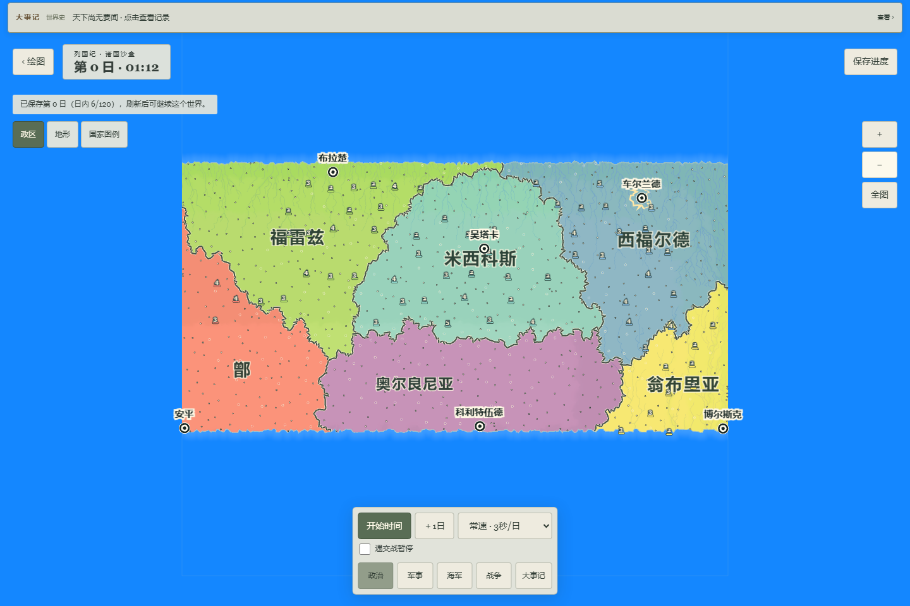
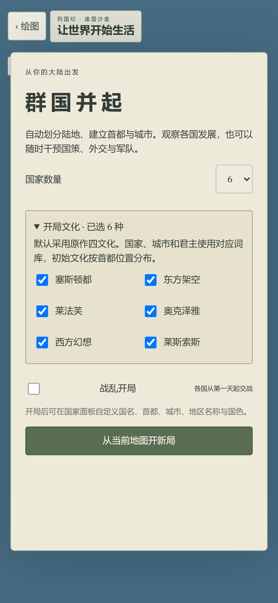

# v18 原作多文化命名：本地可玩交付

2026-10-07。本机入口 http://127.0.0.1:5189/?fms=1 。独立 `.autopilot/naming18-preview/dist`、v18 / Store20 / `lieguoji-fms-naming-v18`；旧5188/v17及旧档保持。父HEAD 92b6309d7f4c5a2bed90ad27e30637b91156d4cd，构建来自当时工作树，源码/43个产物SHA见 tested-artifact.json；不是云端CI结果。

## 已可操作的内容

- 从玩家绘制地图开局，默认原作四文化，可展开选择全部六文化。原词库实际用于国家、城市及君主，创建常备军和首条人物记录之前完成命名；不是只换屏幕文字。
- 国家保留文化身份、原始名称key；人物保留名、原姓、所属家族和显示姓名。族群实际参与资源/财政计算。自定义国家/城市名后来源标记为玩家修改，历史记录不被改写。
- 新版真实Worker运行、暂停、保存与刷新继续；旧版沿旧规则继续，只有明确建立副本才进入新规则/独立库。

正常界面试玩用闭合笔画绘出不规则大陆，预览并确认保形自然化，保存地图后选择六文化/六国/和平开局，生成萨伏依、黎、海讷高、于利希、伊普雷加里亚、埃托罗斯。首个国家的首都沃洛科沃、君主维尔纳 施奈德来自对应文化，267辖区/178军记录。启动连续时间后在第0日11:24暂停保存，刷新继续恢复同一世界。最终UI恢复提示已验证正确，当前页保持暂停、慢速6秒/日和收起面板；控制台未发现错误/警告。没有修改用户其他存档。

## 实际检查范围

- 全量单元3017/255文件通过；另有76项相关定向。全量在最后三个UI改动（稳定城市ID定位、恢复提示、文化选择对齐）之前完成，模拟引擎未改变。
- 首轮多文化/族群浏览器6项通过；桌面既有回归21通过、2个定位失败。失败证据保留，修复说明见 FAILURES.md。
- 最终构建针对命名开局/精确恢复、史书政治操作、小城选择改名，桌面、428×926手机仿真、平板共9项通过，0重试。不是把前21项写成最终构建重跑。
- 最后修改后全工程lint、类型、生产构建及43产物审查通过。24发布与15计划检查已通过；最终任务记录变更再做plan:check。
- 原起义候选独立内核另9项定向通过，在3017之后新增，尚无生产调用者，不计入本版玩法与全量数量。

截图为测试绘图场景（矩形输入用于自动检查），不等于手动不规则大陆存档：

## 继续的原作缺口

分裂新国目前仍为父国文化网页桥；已恢复原起义按省文化、双候选池及旧国复用路径，下一批接真实省文化与复国状态。王朝保留、12–25年任期也仍是网页适配；原生日/死亡、家族亲属继承、完整信仰和官职AI没有接完。原作视觉一致、iPhone Safari/Chrome真机、手机性能及完整PH均未验收。

本批没有push、Pages或main变更，不触发云端发布；原正式站及有界预览授权保持。WEB-04-13和完整还原目标继续。
