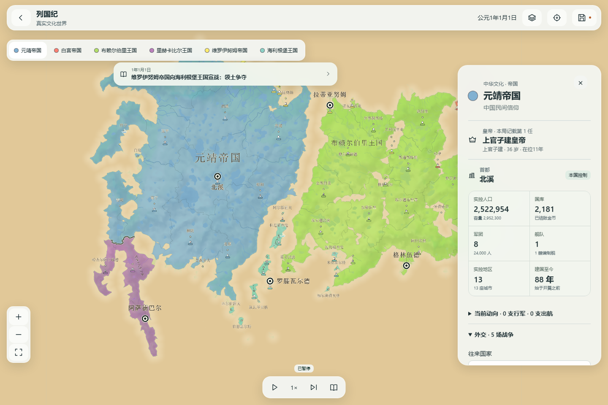
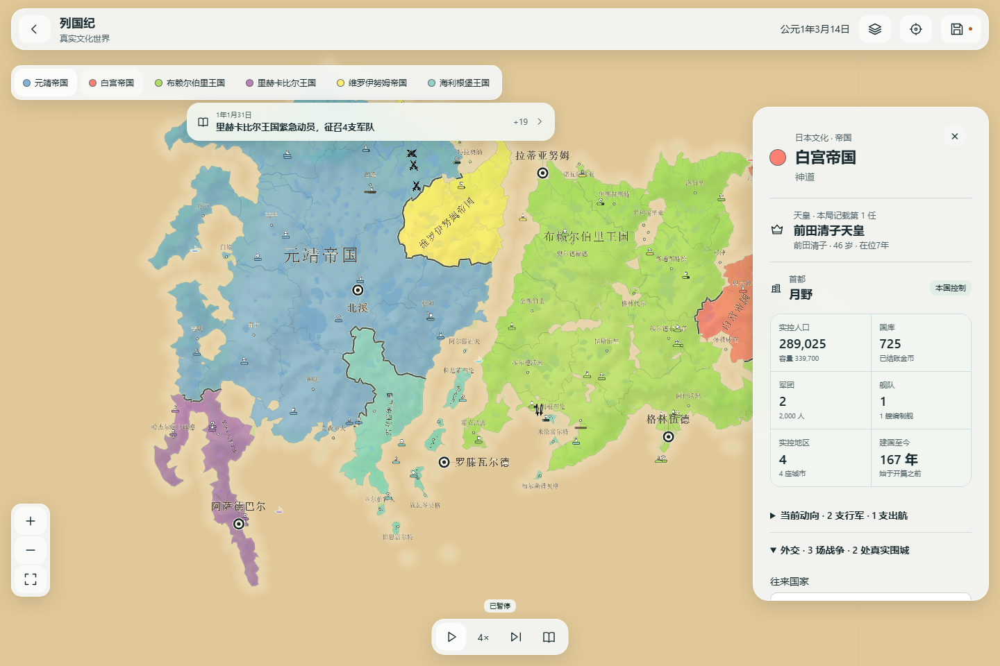

# 持续推演耗时与文化称号：本地部分完成（2026-10-15）

源码 556e39836e22600f65c172024b15b3a298d13d36，引擎 1c7d4309c1820dc00c4425789eb7ef24a1df8780bbbbb71a6ce80a022bbf2a74；检查产物 .autopilot/fms-pacing-titles47-checked。本机试玩：http://127.0.0.1:5334/?fms=1 。新建世界使用新引擎；已有档继续原引擎，不静默迁移。旧5333保留。未上传GitHub、Pages或Cloudflare，未改main、原安装目录或个人档。

本批实际两项：国家面板与新传位事件共用文化称名；海军在同舰队、同决策阶段、同实际起点和权重下复用精确有序寻路前沿。每次仍重验交锋、撤退、目标和港口权限；不改变战争、伤亡、粮程或RNG。国家的自动国号仍随实际政体生成，自定国名保留。

中华与日本不统一追加西式世号，实际浏览器显示“上官子建皇帝”“前田清子天皇”；英格兰显示“拉尔夫一世国王”。中华改共和国后“上官子建总统”。姓名、在位称名、同名计数和本局任次分别保留；没有凭姓名编造年号、庙号或谥号，没有回写旧事件。现有12文化之外未扩库。宫内厅正式称谓见 https://www.kunaicho.go.jp/learn/institution/seido/seido01.html 。故宫人物页搜索支持皇帝用语，但正文直连抓取超时，未把其内容作为完整历史制度还原证据。

同一合成整图36,864点、6国60城、战乱开局与当前三个真实feature开启，分别在旧/新检查产物用独立Chromium上下文顺序运行，4×且国家详情打开。首批Worker响应 3877 → 1589ms；含暂停排空的实际推进 1.42 → 1.87模拟日/秒。开局耗时 13017 → 13801ms，未改善。样本仅两次顺序运行，非稳定倍速、FPS、原作等价或手机性能结论。

独立Node旧Worker/当前源码核心连续24日，完整run/frame/motion精确一致。首4日5261→2433ms，后续旧约587–686ms、新588–746ms；只证明冷批寻路改善，暖机没有普遍提速。CPU采样找到持续接触验证热点；本批未为微小推测收益删验证或堆缓存。最初比较脚本误用显示增量序列而失败，修正脚本按真正协议解码后通过，失败日志保留；不是修改游戏校验来过测试。

定向6文件103测试、lint、typecheck、生产构建94允许产物通过。当前UI推进、中华/日本/英格兰、共和国改制、保存冷恢复（tick8640/部队位置/称号精确一致）通过，无页面异常；428×926只作布局截图。冻结22db原Worker1,411,956字节/sha 0ccacde0a16d738bb249813adfdc9261f331f704f921efc5a2a6cac3627fa275；28项冻结原字节检查及旧22db浏览器继续/保存/恢复通过。完整套件、iPhone/Safari真机、用户视觉验收未跑/未过。

下一批先解决暖机持续吞吐，分开测Worker计算/消息克隆/主线程绘制与显示缓冲，按同整图连续运行验收；不再只改倍速数字或冷首批。然后接回已有实际地图细化、交战点和原作视觉差距。WEB-04-37 in_progress、WEB-04-21 blocked、WEB-02-02 todo/部分证据及全部发布/真机/用户视觉门保持。
