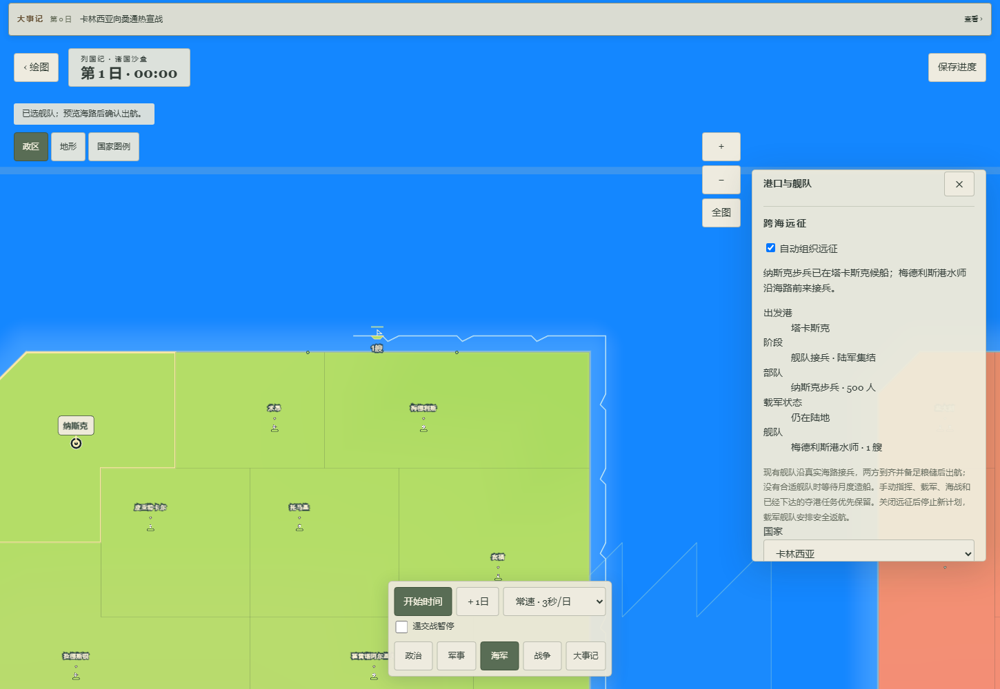
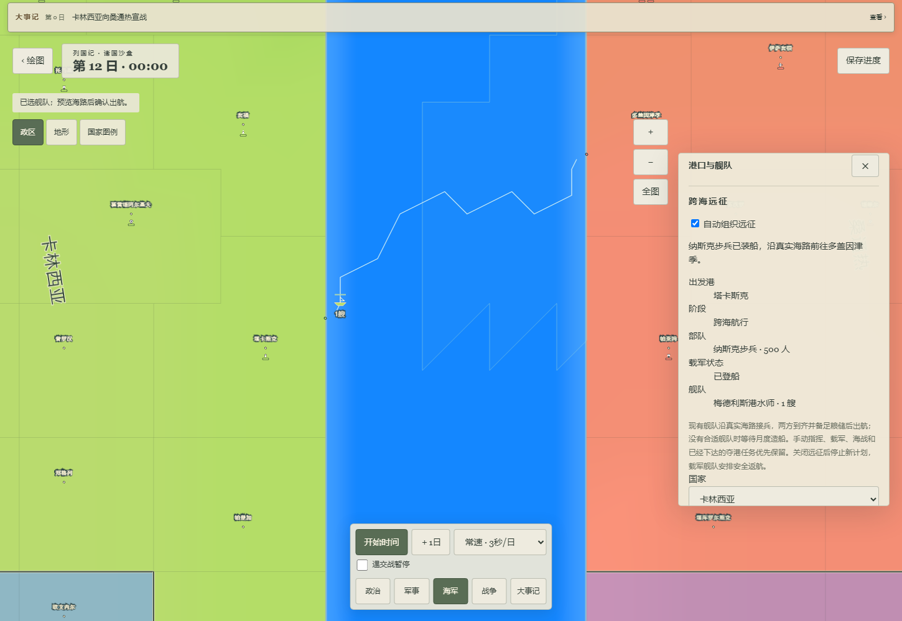
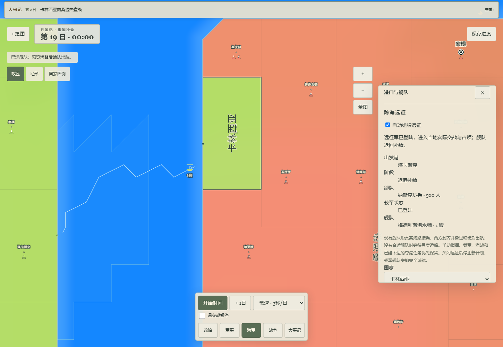
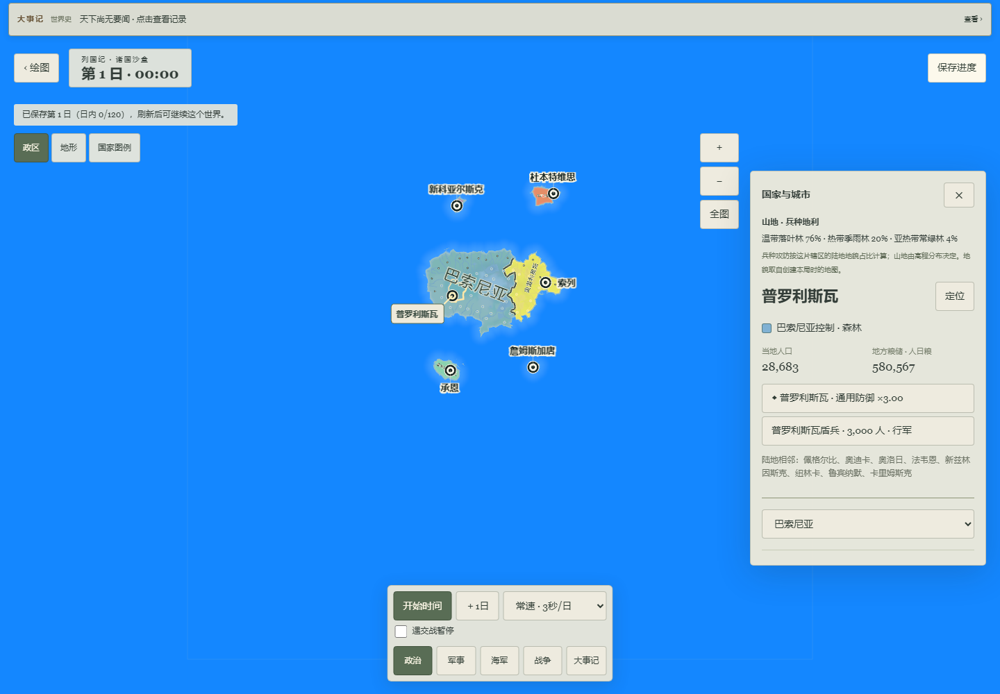

# v46 跨港接兵本地试玩交付

日期：2026-10-08。接续 WEB-04-37，任务仍为进行中。源码提交 `8805226571c93c3622c2dc8002395d3ecd70a506`；规则指纹 `e3191f1edda29829bb24cc1a1ec8ff20336344aa85b7f770769735336a4fd52d`；Store48 / `lieguoji-fms-war-v46`。

## 实际可玩变化

原来远征只能就近取船，而且可以旁路月度造船直接编成舰队。现在会寻找现有、空闲、运力和全程粮储足够的舰队；船可以从另一个本国港口沿真实海格航线驶来，陆军同时走允许的陆路集结。只有双方抵达集结港才装载，随后航行、登陆，空船返港补给。

自动远征不会抢走正在手动航行、载军、海战、撤离或执行夺港命令的舰队。缺船或缺粮时显示等待原因；自动补建继续由原作已恢复的国家月度队列产生实际舰队。海军页显示出发港、阶段、部队身份和是否登船，玩家接管部队可以取消尚未装载的计划。

## 试玩入口与操作

- [本机试玩](http://127.0.0.1:5248/?fms=1)。仅当前电脑可用，不能将此 localhost 地址用于手机。
- 普通入口：在空海放置原作地形或自己绘制 → 保存 → 进入世界 → 选择国家/城市数量 → 从当前地图开新局。应用内浏览器另通过正常 UI 准备一份 6 国 60 城试玩世界，最终状态见 checks.json。
- 在海军页查看港口、月度建造和自动远征。相通海域、敌对目标、合格部队与舰队等条件满足后才会组织接兵，不保证每个随机世界立即发动跨海战。
- 旧 v45 预览为 [5246](http://127.0.0.1:5246/?fms=1)，其 43 个产物哈希未变。不同端口的浏览器存储独立，本批没有搬迁用户旧世界。

## 对照与真实检查

依据为用户授权安装包的限定静态 PE / IL2CPP 实现。DLL、方法地址、散列和实际适配边界见 [CONTRACT.md](CONTRACT.md)、[native-methods.json](native-methods.json)。原作 `Army` 本身有海陆统一路径和海域战斗，而网页仍由运输任务和独立舰队承载。**本批不是这套原作模型的完整等价实现。**

固定双大陆运输样例使用隔离的 4 国 60 城数据，主相机/视口保持一致，依次观察接兵、出海和登陆后的返港。为单独验证物流，将其他守军移动到本国另一地区；没有关闭或修改战斗规则。这些规则夹具不代表自然地图美术。

| 检查 | 本批结果 |
| --- | --- |
| 相关单元与存储/Worker回归 | 4 文件、69 项通过；不是全仓单元套件 |
| 全仓类型与 lint | 通过 |
| 发布与计划保护 | 39 项通过 |
| 生产构建及产物审查 | 43 项游戏产物通过；保留现有大块体积与 Vite 配置警告 |
| 实际生产 Worker 航行 | 2280 tick / 19 日；第 1 日跨港接兵，第 12 日载军出海，第 19 日观察到同一军队已经登陆 |
| 保存恢复 | 接兵途中、海上途中刷新均恢复；旧版本继续运行和备份/CAS回归通过 |
| 取消与冲突 | 手动造船预览取消、远征开关、跨标签 CAS 通过；失败军令不污染当前状态 |
| 普通 UI 新局 | 空海 → 原作地形 → 6 国 60 城 → 第 1 日 → 保存刷新，通过 |
| 浏览器错误 | 两份生产流程均无运行、控制台、请求和 HTTP 错误 |
| 手机布局 | 428×926 桌面 Chromium 仿真无横向溢出；不是 iPhone 真机 |
| 原作视觉、4/16/40倍对照、真机、完整战争任务 | 未通过/未完成，没有由功能测试替代 |

首次失败及具体修复见 [REVIEW.md](REVIEW.md)。原始失败日志和录像保留；当前结果分别绑定 [browser-production.json](browser-production.json)、[browser-newgame.json](browser-newgame.json) 和 [tested-artifact.json](tested-artifact.json)。

接兵前后实际画面：

[完整生产浏览器操作录像](video/page@317fe3e8cdad9b0aaf0672c3d58c92e6.webm)。录像是网页测试操作记录，不是原作实机资料；部分模拟时间由真实 Worker 批次推进。

普通入口截图仍暴露大陆所占比例小、海洋大片平色、近景与原作细节未对齐等问题；运输样例的方格版图不用于掩盖这些差距。它们留在原任务后的全项目对照队列，并未标为美术通过。

## 下一批与边界

继续 WEB-04-37 的统一 Army 海陆行军和海域战斗身份，从已定位的 `Army.<MoveToProvince>d__117.MoveNext` 与 `ArmyPathfinding` 衔接完整输入输出，避免重复恢复小函数。原作裁舰、速度补给、军事任命及内战时序仍有明确差距；之后才到 WEB-03-06 和用户排队的官方/视频全面差距审查。

本批仅本地提交，未 push、未触发 Pages、未改 main/正式站或 pre-push。现有存档和原作安装目录未覆盖，原包、分析 dump、认证、SDK 配置和个人存档不进入 dist。
