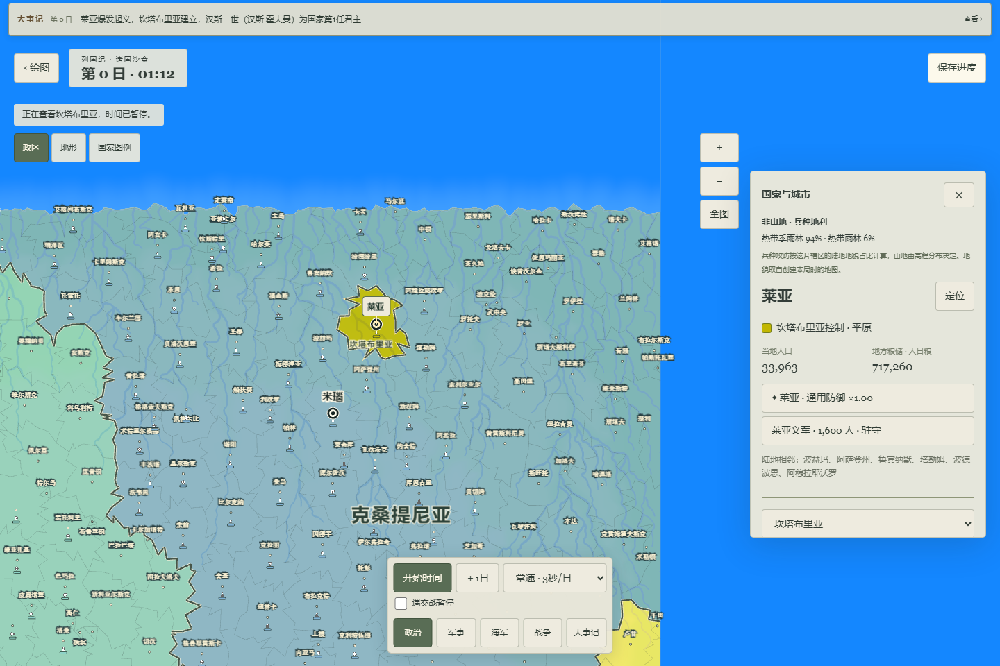
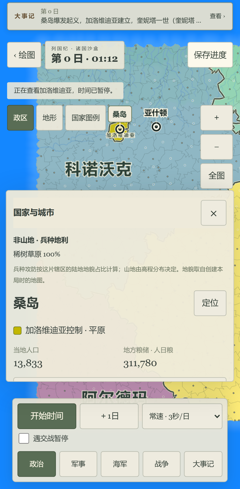

# v19 省文化起义与历史复国：本地试玩

2026-10-07，WEB-PH04 / WEB-04-13继续进行。当前本机入口：<http://127.0.0.1:5191/?fms=1>。独立生产构建在 `.autopilot/restoration19-final-preview/dist`；v19 / Store21 / `lieguoji-fms-restoration-v19`，引擎 `3ce356c1e36c0010cf533c6a498183404bf0a3dbd47b03339651b12211089e57`。不是在线Pages地址，另一台手机不能使用本机127.0.0.1。

## 实际新增

1. 起义保留地区原文化，使用原作名称和身份选择核；既可新建国家，也可在名称条件满足时重新启用历史国家。历史ID、原色、王朝/政体、财政、第三国关系和人物不被临时新国覆盖。
2. 首都地区也可以起义。新国以该地城市为都，母国优先迁往其余核心辖区。仅清除实际位于起义省的母国军队，不误删远征或载军；叛军编号避开旧记录。
3. 复国将新任期绑定真实已记载的人物，保留旧任期与能力。修复多国历史共用旧都导致军令/世界校验失败；不存在的城市引用仍拒绝。载军舰队袭岸/撤航同步目的港，保存后抵岸可继续登陆。

新局直接使用v19；旧局仍按原规则继续，只有明确创建“复国规则副本”才进入新库。原5189/v18及全部旧预览、旧库保留。5190是早期候选，不能当最终版本。

## 浏览器操作证据

最终构建的三尺寸真实Worker流程全部通过（desktop1440×960、Pixel7尺寸、iPad尺寸 Chromium，0重试）：手绘闭合大陆→选择六文化→开局→时间推进暂停→保存→深链接刷新→精确恢复run/checksum→首都起义预览取消→确认→母国迁都→再次保存刷新→恢复新国和史书。无页面错误、控制台error或资源请求失败；[报告](browser.json)。这些是移动仿真，非iPhone13ProMax Safari/Chrome真机。

另通过正常界面手绘不规则大陆，建立巴斯克尼/西秦/加斯科涅/梅拉尼亚/库斯塔里亚/奥林匹奥斯；塔贡起义建立东法利亚，伊沃一世（伊沃 克里格）第1任，母国巴斯克尼迁都泰格，实控181→180。取消首轮预览仍六国；第二次确认后七国。保存刷新，顶部事件及两国首都正确恢复。新标签13保留，暂停、慢速6秒/日；旧标签12/v18不改。

## 检查范围

- 全量3076单元、260文件全部通过；时间及命令见[完整批次](full-batch.json)。此后只修改一行海军命令适配器以接回`transports`，不是对同一修复后版本重跑3076。
- 修复后最终32项受影响测试（v19、历史首都、载军raid/retreat、实际航行/登陆、旧maritime）、完整lint/类型/计划检查/生产构建及43产物审查通过，见[最终检查](checks.json)。历史压力测试沿真实起义命令与原词库，同时显式设置人口/覆亡夹具，不冒充自然发生的历史。
- 24发布规则与15计划规则通过在完整批次中；发布代码未更改。首轮指纹、类型及夹具失败均保留于[失败记录](FAILURES.md)，没有删检查获得绿灯。
- 两槽未知字段（含顶层）旁有已知损坏仍先锁写；主槽已知损坏能取备份并保持CAS。显式v18副本保留旧库，旧session执行不变。
- 受测源码和dist SHA见[tested-artifact](tested-artifact.json)。build.json记录父HEAD 0ec8308；另列实际脏树哈希，不把父提交当新代码或云CI证据。构建仍有>500kB chunk提示，未调高警告门槛掩盖。

## 未完成与接续

完整原家族/年龄候选、真实人物寿命、国运重置/月调度、自然叛乱概率、联盟/附庸/宗教均未因本批通过。当前复国人物选取使用最近已知活前君主的网页适配，不能称完整原继承。地图全倍率密度、长标签引线与原作视觉仍需继续改进，当前不作视觉等价结论。真机、性能、用户视觉门未通过。

下一批接[已闭合的国运公式与调度](NEXT_DESTINY.md)，先独立内核、再冻结v19并持久接入。继续按原计划，不再重复恢复已完成起义选择器。没有push、PR、Issue、Pages触发或main更改，当前有界预览授权不自动扩成完整发布许可。
